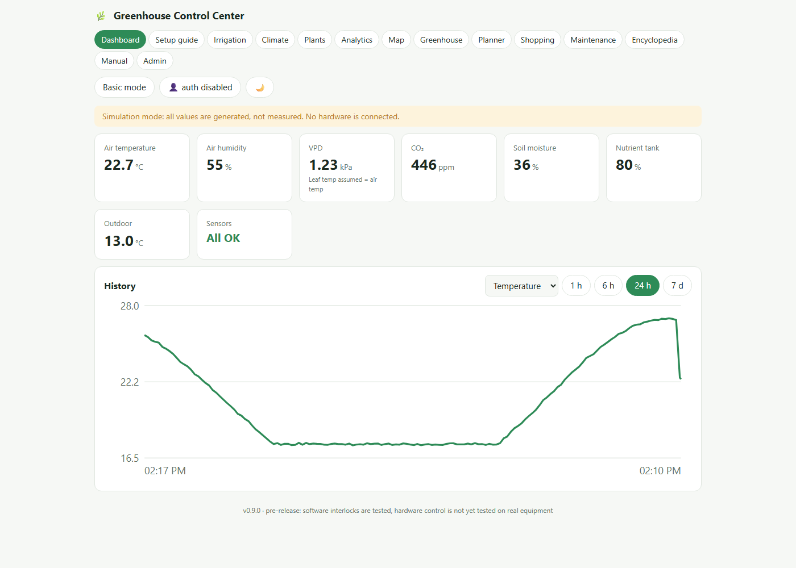
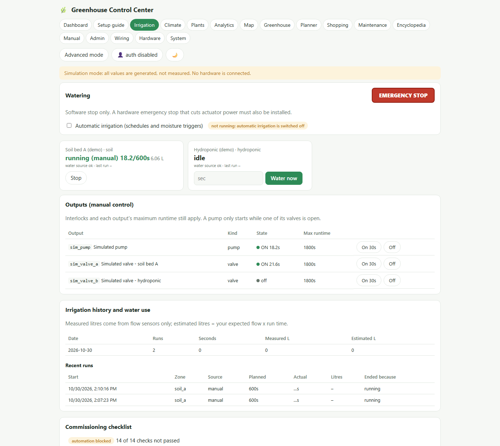
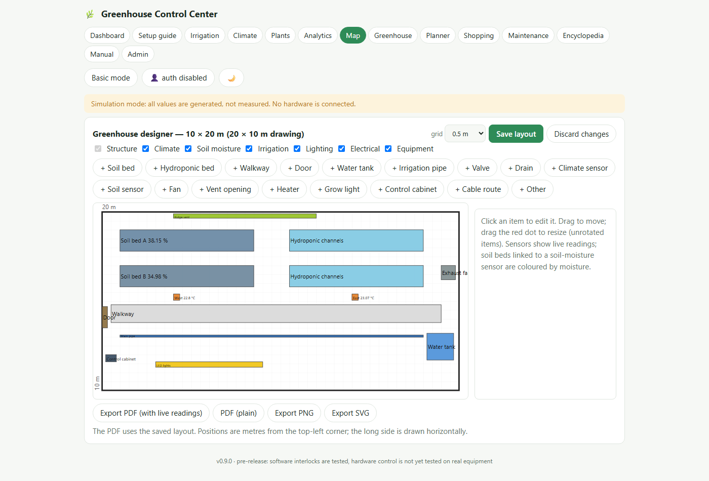
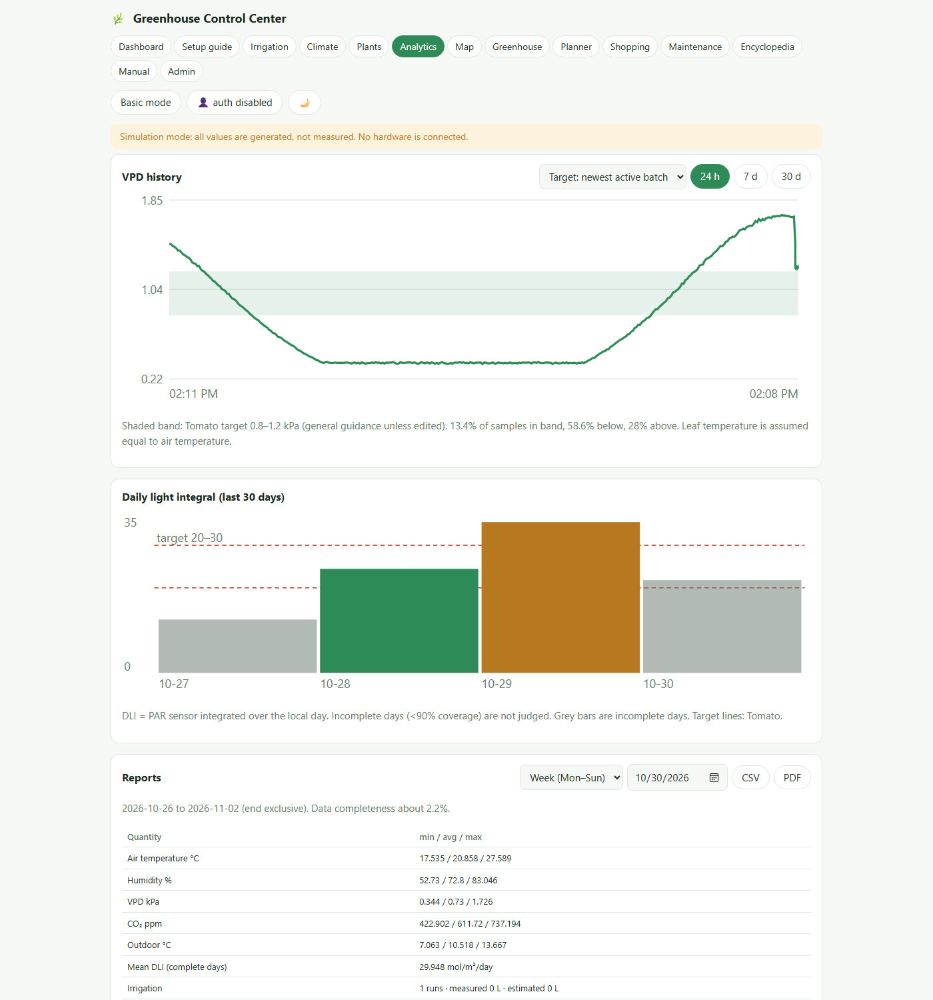
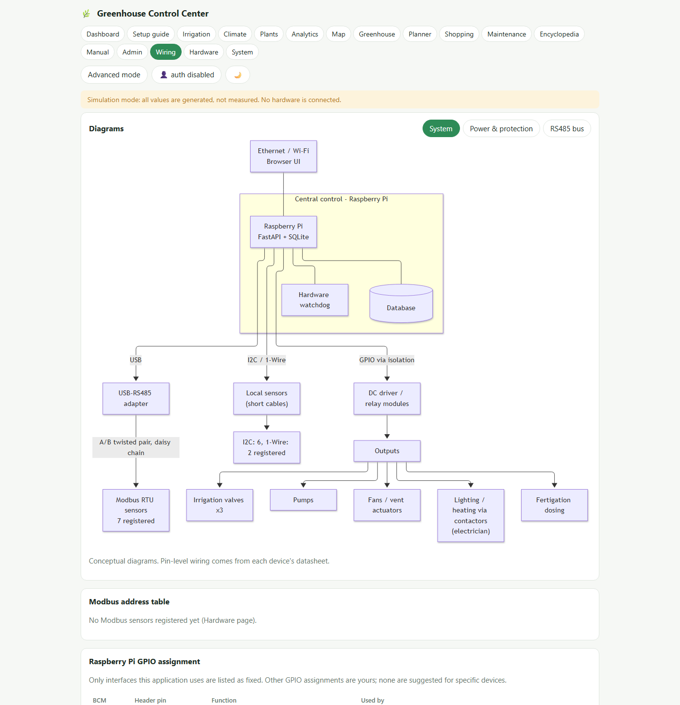
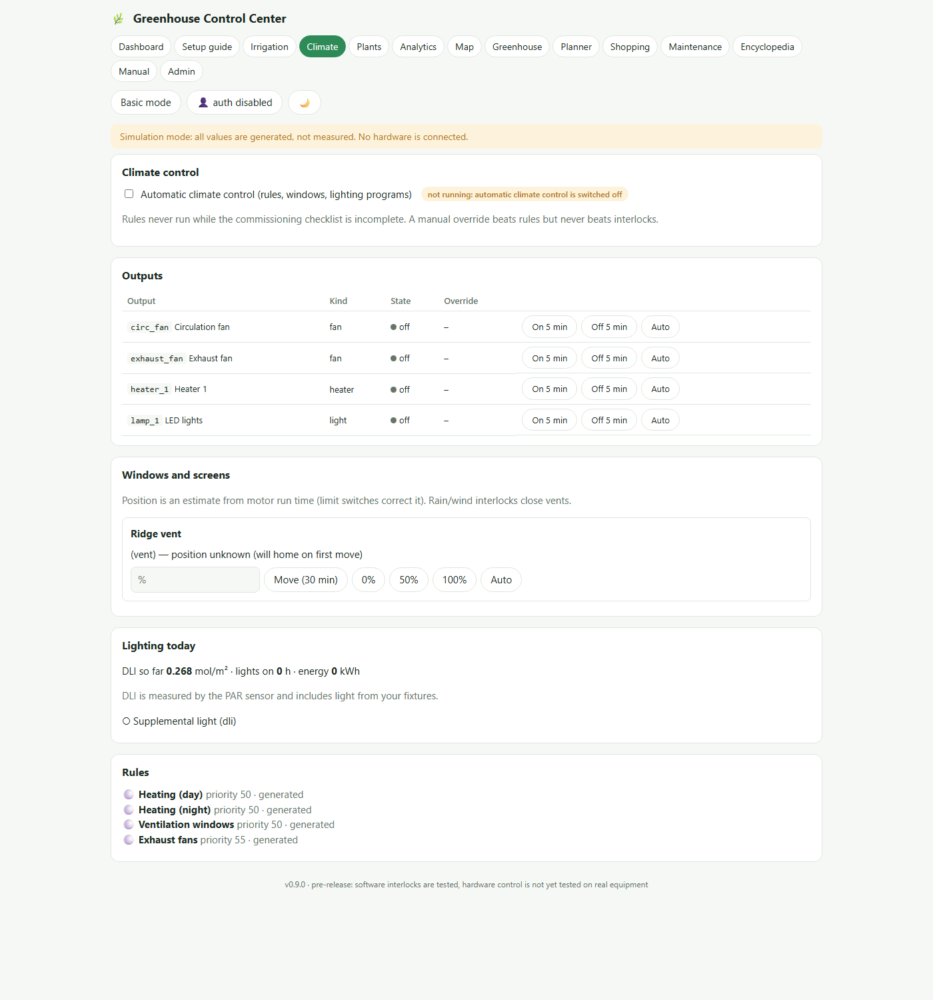
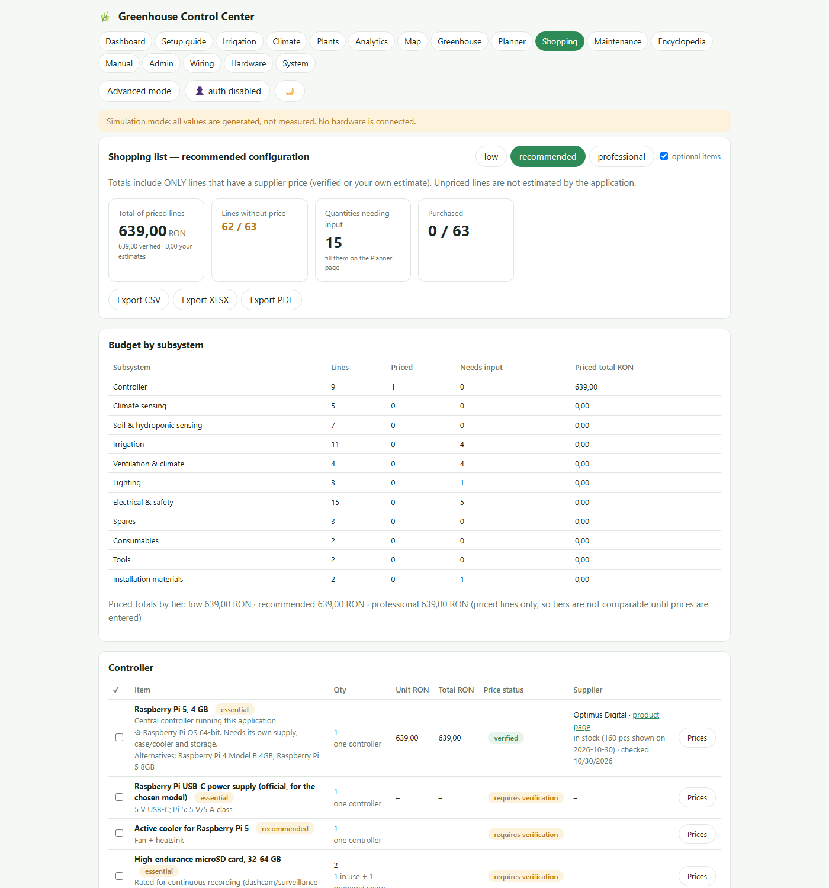
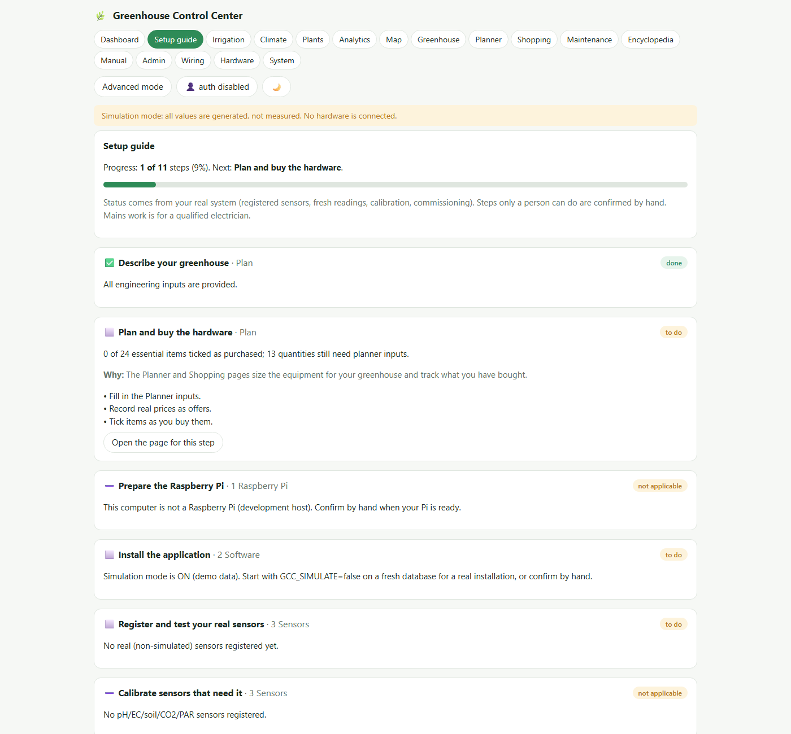
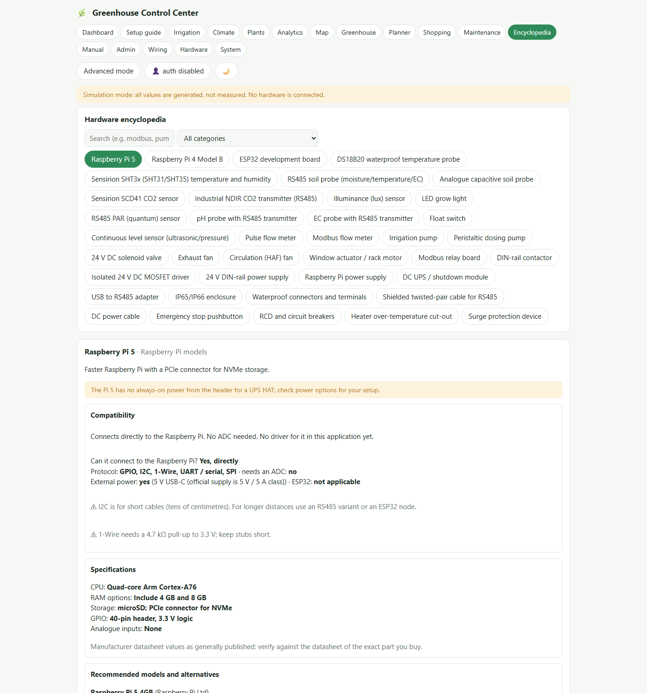

# Greenhouse Control Center

**Local-first greenhouse monitoring, irrigation and climate automation for Raspberry Pi.** Read sensors over Modbus/RS485, I2C and 1-Wire, run irrigation, ventilation, heating and lighting behind safety interlocks, plan and buy the hardware, and get a personalised installation manual, maintenance schedule, backups and a troubleshooting assistant. Everything runs on your own network; no cloud service is needed. Built around a 10 m x 20 m (200 m²) greenhouse in Romania growing in soil and hydroponics, with prices in RON, but sizing adapts to any greenhouse.

> ⚠️ **Pre-release (v0.9.0): the logic is thoroughly tested, the hardware is not.** 284 automated tests pass against simulated and emulated sensors, outputs and buses, and the program survives hard kills and restarts. But **no real sensor, relay, pump, valve or motor has ever been driven by this code, and it has not run on a Raspberry Pi.** Use it for a supervised pilot, keep independent hardware protections, and read [Production readiness](docs/PRODUCTION_READINESS.md) before letting it control anything unattended. Mains wiring must be done by a qualified electrician.



<details open>
<summary><b>More screenshots</b> (all from the built-in demo mode with synthetic data: every value is simulated and says so)</summary>

| | |
|---|---|
|  **Irrigation:** zones, emergency stop, run history |  **Greenhouse map** with live readings |
|  **VPD and DLI** against crop targets, reports |  **Wiring diagrams** generated from your configuration |
|  **Climate control:** rules, windows, lighting |  **Shopping list and budget** (prices only where recorded) |
|  **Setup guide** that tracks your real system |  **Hardware encyclopedia** with compatibility checker |

</details>

## What it does

- **Monitor:** Modbus RTU/RS485 sensors (register maps from your datasheets), SHT3x (I2C), DS18B20 (1-Wire), GPIO inputs; calibration; dashboard, VPD, DLI, history, daily/weekly/monthly reports (CSV/PDF), seasonal comparison.
- **Control:** irrigation (zones, pumps, valves, tanks, flow monitoring, schedules, moisture triggers) and climate (rule builder with hysteresis, heating, ventilation, motorised windows, lighting programs). Every output has a hard maximum runtime; anything uncertain means OFF; a latched emergency stop; and a **commissioning checklist that must pass before anything runs automatically**.
- **Plan and buy:** hardware planner (sized from *your* inputs, never invented numbers), shopping list and budget with CSV/Excel/PDF export, wiring diagrams, a 39-page hardware encyclopedia with a compatibility checker.
- **Guide and document:** a setup guide driven by your real system, personalised installation manual and printable checklists (PDF/HTML/Markdown), maintenance schedule, diagnostics, and plain-English explanations of 30+ error messages.
- **Crops:** editable plant profiles (general guidance, clearly labelled), crop batches and harvests, a 2D greenhouse map.
- **Protect:** sign-in with viewer/operator/admin roles, audit log, daily verified backups with restore, hourly roll-ups so history reaches back years.

**Honesty rules built into the product:** it never invents prices, product links, availability or specifications (prices appear only where a supplier offer was recorded); estimates and assumptions are labelled; simulated devices are always marked; crop ranges are *general guidance, not verified recommendations*.

## Install

Requirements: a Raspberry Pi 4 or 5 (4 GB) with Raspberry Pi OS 64-bit (or any computer with Python 3.11+ for trying it out).

**On a Raspberry Pi (recommended: release archive, no Node needed).** Prepare the Pi first ([Raspberry Pi setup](docs/RASPBERRY_PI_SETUP.md): OS, SSH, fixed address, **time zone**, I2C/1-Wire), then:

```bash
wget https://github.com/unupunct/GREENHOUSE-CONTROL-CENTER/releases/download/v0.9.0/greenhouse-control-center-0.9.0.tar.gz
tar xzf greenhouse-control-center-0.9.0.tar.gz
cd greenhouse-control-center-0.9.0
sudo ./deploy/install.sh
```

This installs a systemd service (starts at boot, restarts on failure) with data in `/var/lib/greenhouse`. Open `http://<pi-address>:8000` and create the administrator with the one-time code from `sudo cat /var/lib/greenhouse/setup_code.txt`. *The installer is untested on a Raspberry Pi: read it first and expect small fixes.* Details, firewall, HTTPS and backups: [Installation](docs/INSTALLATION.md).

**From source (Windows, Linux, macOS), also the easiest way to try it with demo data:**

```bash
git clone https://github.com/unupunct/GREENHOUSE-CONTROL-CENTER.git
cd GREENHOUSE-CONTROL-CENTER

cd backend
python -m venv .venv
.venv/Scripts/pip install -r requirements-dev.txt     # Linux/macOS: .venv/bin/pip
.venv/Scripts/python -m pytest -q                      # optional: 284 tests, about 90 s

cd ../frontend
npm install && npm run build                           # Node 20+; builds the web interface

cd ../backend
.venv/Scripts/python -m uvicorn app.main:create_app --factory --port 8000
```

Open <http://127.0.0.1:8000>. With a fresh database it starts in **demo mode** (simulated sensors and equipment, clearly marked) so you can explore everything without hardware. For a real installation start with `GCC_SIMULATE=false`. First start asks for the one-time setup code in `data/setup_code.txt`. (`GCC_AUTH_REQUIRED=false` turns sign-in off: isolated development machines only.)

## Hardware list

The full, generated list for a 200 m² soil + hydroponic greenhouse, with quantities where they can be calculated and the inputs still needed where they cannot, is in **[docs/HARDWARE_LIST.md](docs/HARDWARE_LIST.md)** (regenerate it for your own greenhouse from the Shopping page). In short:

| Subsystem | What you need |
|---|---|
| Controller | Raspberry Pi 5 (4 GB) or Pi 4, official power supply, active cooler, high-endurance microSD or NVMe/USB SSD, IP-rated enclosure, isolated USB-RS485 adapter, DC UPS or clean-shutdown plan, Ethernet switch |
| Climate sensing | SHT35 temperature/humidity per climate station (2 for 200 m²) with radiation shields, outdoor sensor, CO₂ sensor, PAR (quantum) sensor |
| Soil / hydroponic sensing | RS485/Modbus soil probes (2 per zone), DS18B20 solution probe, pH and EC probes with transmitters, tank level sensor, **float switches for the pump cut-out**, flow meters, pressure sensors |
| Irrigation | Reservoir, pump(s) with check valves and filters, pressure regulators, 24 V DC solenoid valves (one per zone), manifolds, drip line and drippers, dosing pumps for fertigation |
| Ventilation, heating, lighting | Exhaust and circulation fans, window actuators with limit switches, heating (with independent over-temperature cut-out), LED grow lights, energy meter |
| Electrical and safety | 24 V DIN-rail supply with fuse per feeder, MOSFET/relay modules, contactors, RCD and breakers, surge protection, **hardware emergency stop**, earthing, shielded twisted-pair cable, IP65/66 cabinet, glands, connectors |

Specifications and prices are **not** invented: items are generic requirements until you choose a product, and a price shows only where a supplier offer was recorded (so far a single item, the Raspberry Pi 5). See [Shopping list](docs/SHOPPING_LIST.md) and [Budget](docs/BUDGET.md).

## Set up the entire system

The complete order of work, from planning to going live, is in **[docs/SETUP_GUIDE.md](docs/SETUP_GUIDE.md)** (the app's *Setup guide* page tracks the same steps from your real system):

1. **Try it** with demo data, no hardware.
2. **Describe the greenhouse** and enter datasheet values in the **Planner**; research and record prices on the **Shopping** page; have an electrician design the mains side.
3. **Prepare the Pi** (OS, network, time zone) and **install** the software; create the administrator; set daily **backups** with a copy folder on a USB drive.
4. **Build the cabinet and wire the sensors** (RS485 daisy chain, I2C, 1-Wire); register, test and **calibrate** every sensor.
5. **Install the water system** with a hardware float switch in the pump circuit; register pumps, valves, tanks and zones; same for fans, heaters, windows and lights with their independent hardware protections.
6. **Define rules, schedules and crops**, generate your personalised **manual** and keep a printed copy in the cabinet.
7. **Commission:** run the software checks and perform/attest the physical ones (hardware e-stop, float switch, outputs, heater protection, window limits, restart).
8. **Supervised trial**, then enable automatic control. Checklist: [Production readiness](docs/PRODUCTION_READINESS.md).

## Documentation

| | |
|---|---|
| Start here | [Setup guide](docs/SETUP_GUIDE.md) · [Production readiness](docs/PRODUCTION_READINESS.md) · [Status and gaps](docs/STATUS.md) · [Safety](docs/SAFETY.md) · [Security](docs/SECURITY.md) · [Architecture](docs/ARCHITECTURE.md) |
| Install | [Raspberry Pi setup](docs/RASPBERRY_PI_SETUP.md) · [Installation](docs/INSTALLATION.md) · [Backup and restore](docs/BACKUP_RESTORE.md) |
| Hardware | [Hardware list](docs/HARDWARE_LIST.md) · [Hardware guide](docs/HARDWARE_GUIDE.md) · [Sensors](docs/SENSOR_GUIDE.md) · [Modbus/RS485](docs/MODBUS_SETUP.md) · [Wiring](docs/WIRING_GUIDE.md) · [ESP32 (not implemented)](docs/ESP32_SETUP.md) |
| Operate | [Irrigation](docs/IRRIGATION_GUIDE.md) · [Ventilation, heating, lighting](docs/VENTILATION_GUIDE.md) · [Calibration](docs/CALIBRATION_GUIDE.md) · [Plants, analytics, map](docs/KNOWLEDGEBASE_AND_ANALYTICS.md) |
| Maintain | [Maintenance](docs/MAINTENANCE.md) · [Troubleshooting](docs/TROUBLESHOOTING.md) |
| Buy | [Shopping list](docs/SHOPPING_LIST.md) · [Budget](docs/BUDGET.md) |
| Develop | [Testing](docs/TESTING.md) · [Performance](docs/PERFORMANCE.md) |

## Project layout

```
backend/   FastAPI + SQLite application (app/), tests (tests/), requirements (.txt, .lock)
frontend/  React + TypeScript web interface (npm run build -> dist/, served by the backend)
deploy/    systemd service and installer for Raspberry Pi OS
docs/      all guides, generated hardware list, screenshots
scripts/   benchmark, soak test, demo-data helpers, release builder
```

## Not implemented (yet)

ESP32/MQTT remote nodes, a dedicated SCD41 driver, pulse-counting flow meters, nutrient dosing/EC-pH control loops, PID control, heating-load calculation, SMS/e-mail notifications, two-factor sign-in, TLS built in (use a reverse proxy). Full list: [docs/STATUS.md](docs/STATUS.md).

## Safety and disclaimer

Mains wiring must be done by a qualified electrician. Heater, pump and actuator protections must work independently of this software. Never connect mains voltage to Raspberry Pi GPIO or to hobby relay boards. The software blocks automatic operation until the commissioning checks pass, but it cannot prove that you did the physical tests. This is pre-release software provided as is, without warranty: you are responsible for your installation, your crops and your safety.

## License

No license has been chosen yet; until one is added, all rights are reserved by the author.
