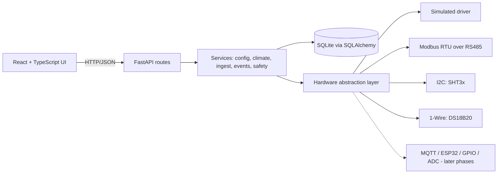

# Architecture

Greenhouse Control Center runs entirely on the local network, on a Raspberry Pi (or a development PC). No cloud service is required.

## Layers

| Layer | Path | Responsibility |
|---|---|---|
| API | `backend/app/api` | HTTP only; no business logic |
| Services | `backend/app/services` | Config model, VPD, polling/aggregation, events/alerts, safety gate, host info |
| HAL | `backend/app/hal` | `SensorDriver` protocol + driver registry. The rest of the app sees values, never buses |
| Core | `backend/app/core` | Settings (env `GCC_*`), SQLite engine, tables |
| UI | `frontend/src` | Dashboard, Greenhouse config, System (advanced) |

New hardware = a new driver class registered in `hal/registry.py`; nothing above the HAL changes. A driver declares `validate_address`, `conflict_key` and `read` (raw value). Shared handles (Modbus buses, I2C, 1-Wire path) travel in `HalContext`, which tests replace with emulated buses. Calibration (`calibrated = gain*raw + offset`) is applied by the ingest service, not by drivers.

## Data flow and storage wear

Sensors are polled every `GCC_POLL_INTERVAL_S` (default 5 s) into memory. Every `GCC_FLUSH_INTERVAL_S` (default 60 s) one **averaged** row per sensor is written. SQLite runs in WAL mode with `synchronous=NORMAL`. Rows older than `GCC_RETENTION_DAYS` (default 90) are pruned daily. Pending samples are flushed on clean shutdown; a power cut loses at most one flush interval.

## Configuration model

`GreenhouseConfig` (`services/greenhouse_config.py`) holds the owner's stated facts as defaults (10 m x 20 m = 200 m², soil + hydroponics, full automation, Romania, RON, English). Facts the owner has **not** stated (height, ridge height, orientation, covering, heating need, water pressure, electricity supply, location) default to `None` and are listed by `GET /api/config/engineering-inputs`. Derived values that depend on them (e.g. volume) are `null` until provided. The floor-area/volume figures are labelled estimates.

Provenance vocabulary used across the project: **verified** (checked against a manufacturer datasheet or live supplier page), **estimate** (calculated or approximate, configurable), **assumption** (stated explicitly and replaceable). Phase 1 contains no product or price data.

## Safety principle

Safety-critical protections (thermal cut-outs, float switches, e-stop, breakers/RCD, motor limit switches) must be **hardware-independent** of this software. The software also refuses production automation until a verification suite passes (`services/safety.py`, `GET /api/safety`). In Phase 1 the gate is permanently closed: there are no actuator drivers.

## API (Phase 1)

`GET /api/health`, `GET|PUT /api/config`, `GET /api/config/engineering-inputs`, `GET /api/sensors`, `GET /api/readings/history`, `GET /api/climate/vpd`, `GET /api/climate/vpd/history`, `GET /api/events`, `GET /api/alerts`, `POST /api/alerts/{id}/ack`, `GET /api/system`, `GET /api/safety`. Interactive API docs at `/docs` are disabled by default (`GCC_API_DOCS=true` enables them).

## Hardware registry API (Phase 2)

`GET /api/hardware/drivers`, `GET|PUT /api/hardware/buses`, `POST /api/hardware/buses/{id}/scan`, `GET /api/hardware/serial-ports`, `GET /api/hardware/1wire/devices`, `POST|PUT|DELETE /api/sensors[/{id}]`, `POST /api/sensors/{id}/test-read`, `GET|POST /api/sensors/{id}/calibration`.

## Planner API (Phase 3)

`backend/app/planner`: `options.py` (inputs), `sizing.py` (calculations), `catalog.py` (bill of materials), `shopping.py` (offers, budget), `suppliers.py` (observed facts only), `export.py`, `wiring.py`. Endpoints: `GET|PUT /api/planner/options`, `GET|POST /api/planner/plan`, `POST /api/planner/cable`, `GET /api/shopping`, `GET /api/shopping/suppliers`, `POST|DELETE /api/shopping/offers`, `PUT /api/shopping/purchased/{id}`, `GET /api/shopping/export.{csv,xlsx,pdf}`, `GET /api/wiring/diagrams`, `GET /api/wiring/modbus`, `GET|PUT /api/wiring/gpio`.

Rule: prices, URLs, availability and specifications are never generated. They enter the system only as recorded offers.

## Irrigation and safety (Phase 4)

`app/automation/rules.py` (pure interlock functions), `engine.py` (desired-state reconciliation, sequencing, supervision), `services/commissioning.py` (checklist and gate), `hal/outputs.py` (output drivers), `hal/plant.py` (simulated water plant). Endpoints: `/api/irrigation/{setup,status,settings,history,zones,tanks}`, `/api/actuators`, `/api/actuators/{id}/command`, `/api/safety` (+ `/estop`, `/estop/reset`, `/checks/{id}/run|attest`).

The engine switches nothing on without passing interlocks, enforces per-output runtime ceilings every tick, and treats any uncertainty as OFF.

## Climate automation (Phase 5)

`automation/climate_rules.py` (pure: hysteresis, rule timing, priority resolution, interlock filtering, window motion), `automation/climate.py` (ClimateEngine: rules, windows, lighting programs, runtime ceilings), `api/climate.py`. Endpoints under `/api/climate/` (`setup`, `status`, `settings`, `rules`, `windows`, `lights`, `templates/setpoints`, `lighting/history`) plus the shared `/api/actuators` for climate outputs. Irrigation and climate engines own disjoint output kinds; the e-stop latch lives in the irrigation engine and the climate engine reads it.

## Knowledge, analytics, map (Phase 6)

`knowledge/plants.py` (built-in profiles, merge/validate), `api/knowledge.py` (profiles, overrides, custom crops, batches, harvests, live check), `analytics/stats.py` + `report.py` + `api/analytics.py` (aggregates, DLI integration, reports, seasonal, exports), `api/layout.py` (layout storage/validation/PDF). Endpoints: `/api/plants`, `/api/crops`, `/api/analytics/{dli,vpd,report,seasonal,export/measurements.csv}`, `/api/layout`. Profile values are guidance, user overrides are stored separately from the built-ins.

## Guides, manuals, maintenance (Phase 7)

`knowledge/hardware.py` (category text + item facts, compatibility rules), `api/encyclopedia.py`; `services/wizard.py` (steps computed from live state) + `api/wizard.py`; `manual/content.py` (sections from the live config), `manual/render.py` (Markdown/HTML/PDF, SVG and drawn diagram) + `api/manual.py`; `services/maintenance.py` + `api/maintenance.py`; `services/diagnostics.py` (health, comms, diagnosis), `services/troubleshoot.py` (message explanations), `api/diagnostics.py`. An hourly housekeeping task raises maintenance-due and host-health alerts.

## Security, backup, performance (Phase 8)

`security.py` (middleware: sessions, roles, CSRF, size limits, audit, headers) with `services/auth.py` and `api/auth.py`; `services/backup.py` + `api/backup.py`; `services/rollup.py` (hourly roll-ups and aligned pruning). Role policy lives in `services/auth.py` (`required_role`): anything not listed is administrator-only. The commissioning gate is memoised per engine (`invalidate_gate`). See SECURITY.md, BACKUP_RESTORE.md, PERFORMANCE.md.

## Deployment

Phase 1 runs with uvicorn (`scripts/run-dev.ps1`, or `python -m uvicorn app.main:create_app --factory`). The built frontend (`frontend/dist`) is served by the backend. Systemd unit, install script and Docker are Phase 2/8 deliverables and are not yet written.
